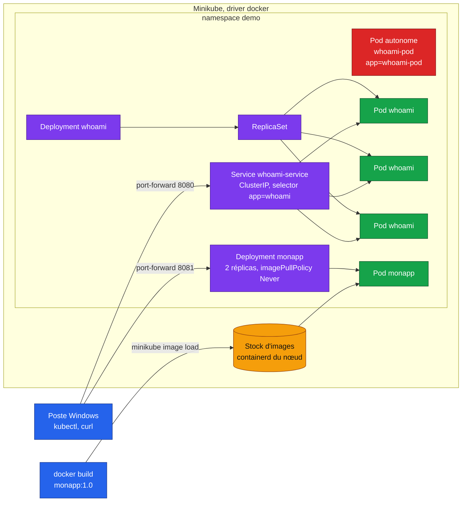

# TP Kubernetes : premiers déploiements avec Minikube et Docker


[](https://github.com/Adam-Blf/tp-kubernetes-minikube/actions/workflows/ci.yml)
<!-- adam-badges:start -->
[](https://github.com/Adam-Blf/tp-kubernetes-minikube/commits)
[](https://hits.sh/github.com/Adam-Blf/tp-kubernetes-minikube/)
[](https://github.com/Adam-Blf/tp-kubernetes-minikube/commits)
[](https://github.com/Adam-Blf/tp-kubernetes-minikube)
[](LICENSE)
<!-- adam-badges:end -->

EFREI, M2 Data Engineering & IA, module DevOps (cours Nowledgeable « devops M2 efrei DATA »).
Rapport complet avec toutes les captures : [`docs/RAPPORT.md`](docs/RAPPORT.md).

## Membres du binôme

- Adam Beloucif
- Emilien Morice

## Versions

| Outil | Version |
|---|---|
| Docker (client et serveur) | 29.8.2 |
| kubectl (client) | v1.36.1 |
| Minikube | v1.39.0 |
| Kubernetes (nœud) | v1.37.0 |
| Environnement | Windows 11, Docker Desktop (WSL2), driver docker |

## Architecture



Le Pod autonome est en rouge : rien ne le recrée. Il porte volontairement le label
`app=whoami-pod` pour rester hors du Service.

## Arborescence

```
.
├── README.md                 ce fichier
├── reponses.md               réponses aux questions du TP
├── manifests/                pod.yaml, deployment.yaml, service.yaml
├── monapp/                   index.html, Dockerfile (nginx:1.27)
├── monapp-deployment.yaml    Deployment monapp, 2 réplicas
├── preuves/                  captures PNG légendées et sorties brutes .txt
├── docs/                     RAPPORT.md (rapport complet), pod-autonome.md (mini doc)
├── scripts/                  rejouer_tp.sh (rejoue tout le TP), render_preuves.py
├── contributions/            fichiers d'origine du binôme
└── .github/workflows/        ci.yml (lint + e2e sur kind), release.yml
```

## Étapes réalisées

| § | Étape | Preuve |
|---|---|---|
| 3 | Versions, `minikube start --driver=docker`, `status`, `docker ps`, `cluster-info`, nœud, pods système | `preuves/01-cluster.png` |
| 4 | Namespace `demo`, Pod `whoami-pod` : `get`, `describe`, `logs`, `hostname`, suppression sans retour | `preuves/06-pod-autonome.png` |
| 5 | Deployment `whoami` à 3 réplicas, ReplicaSet, labels, `describe` | `preuves/02-deployment.png` |
| 5 | Suppression d'un Pod : `Terminating` à côté de son remplaçant, `get pods -w` | `preuves/03-autoreparation.png` |
| 5 | `scale` à 5, 0 puis 3, `rollout status` | `preuves/03b-mise-a-l-echelle.png` |
| 6 | Service ClusterIP, endpoints, `port-forward` 8080 et `curl` | `preuves/04-service-http.png` |
| 7 | `docker build`, `minikube image load`, Deployment `monapp`, `port-forward` 8081 | `preuves/05-image-personnalisee.png` |
| 10 | Suppression des ressources et du namespace, `minikube stop` | `preuves/10-nettoyage.png` |

Tout le TP se rejoue d'une commande : `bash scripts/rejouer_tp.sh` écrit les sorties
dans `preuves-new/`, puis `python scripts/render_preuves.py preuves-new` produit les PNG.

## Répartition dans le binôme

- **Emilien Morice** : partie Pod autonome, démarche et conclusion reprises dans
  `reponses.md` et dans la mini doc `docs/pod-autonome.md`, première version de `pod.yaml`
  (conservée dans `contributions/emilien-morice/`).
- **Adam Beloucif** : cluster, Deployment, Service, image personnalisée, preuves, CI et rapport.

Écarts entre sa première version et le manifeste retenu : label `app: whoami-pod` au lieu
de `app: whoami` (sinon le Service capte le Pod autonome), port nommé `http` pour
`targetPort: http`, et `hostname` lu par `kubectl debug` car l'image n'a pas de shell.

## Intégration continue

- `ci.yml` : validation des manifestes (kubeconform, schéma strict), lint du Dockerfile
  (hadolint), présence des livrables, puis déploiement réel sur un cluster kind avec test
  d'auto-réparation et de réponse HTTP.
- `release.yml` : sur un tag `vX.Y.Z` égal à `VERSION`, construit l'archive
  `Beloucif_Morice_TP_Kubernetes.zip`, publie l'image `ghcr.io/adam-blf/tp-kubernetes-monapp`
  et crée la release avec les notes du CHANGELOG.

## Difficultés rencontrées

- **`kubectl exec -it whoami-pod -- sh`** échoue : `traefik/whoami` ne contient ni shell ni
  binaire `hostname`. Le nom d'hôte est lu avec un conteneur éphémère :
  `kubectl debug whoami-pod --image=busybox:1.36 --target=whoami -- hostname` renvoie `whoami-pod`.
- **Démarrage de Minikube** : cluster existant réutilisé. Le premier redémarrage a pris une
  quinzaine de minutes (chargement de l'image `kicbase` depuis le cache), et la taille mémoire
  d'un profil existant ne peut pas être changée sans `minikube delete`.
- **Ressources partagées** : un autre TP (Kafka, Spark, Postgres) tournait en parallèle.
- **Port-forward** : il s'attache à un seul Pod, donc le `Hostname` reste le même d'un `curl`
  à l'autre ; la répartition du Service ne s'observe pas par ce biais.
- `kubectl get endpoints` affiche un avertissement de dépréciation (EndpointSlice depuis 1.33).

## Licence

MIT, voir [LICENSE](LICENSE).
