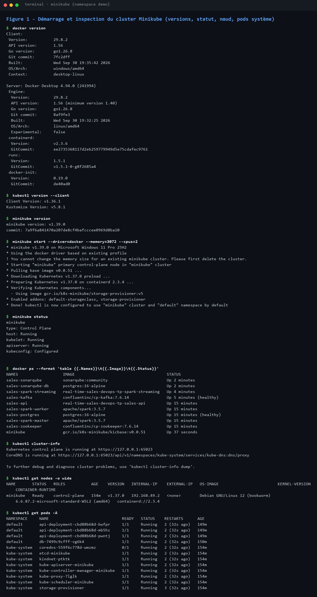
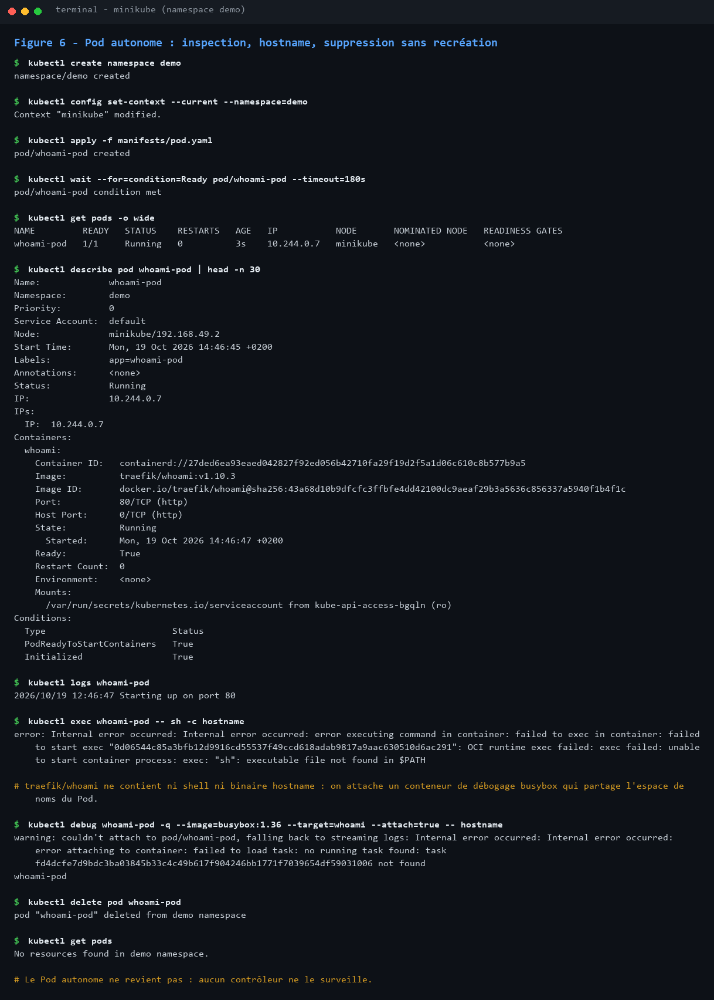
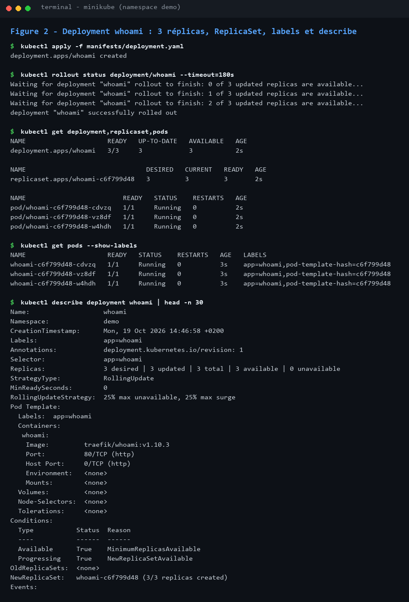
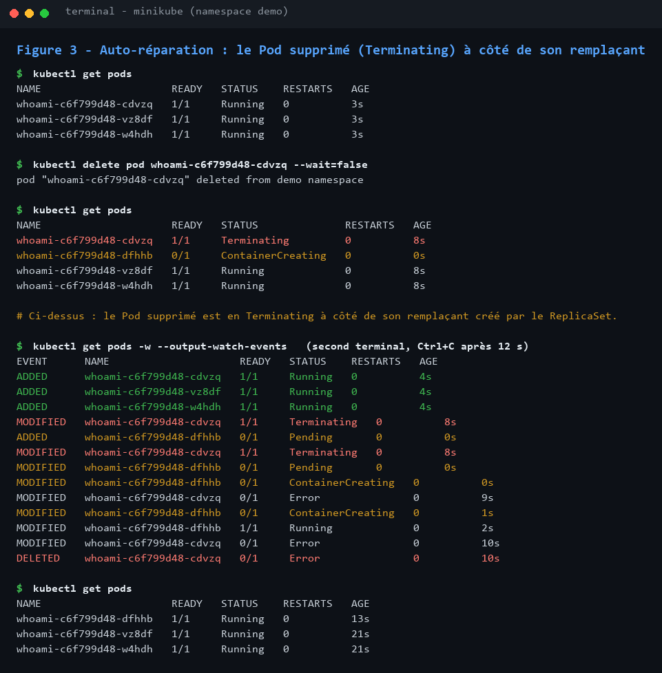
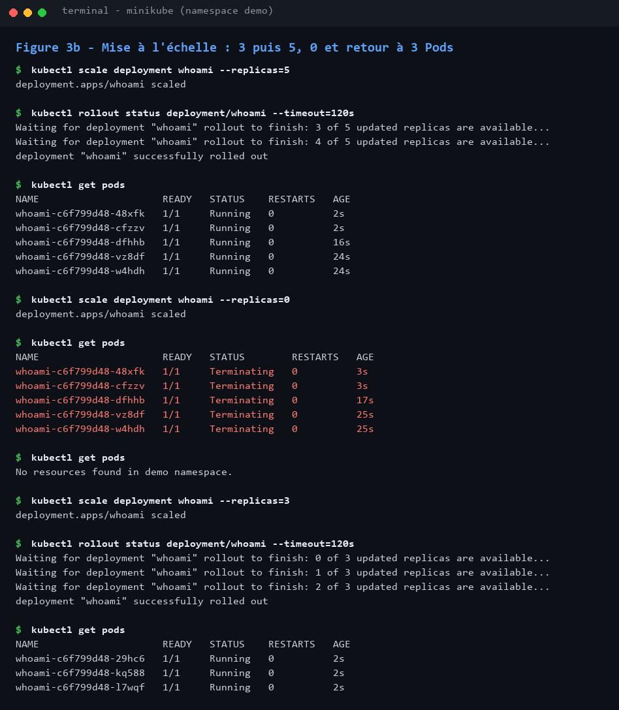
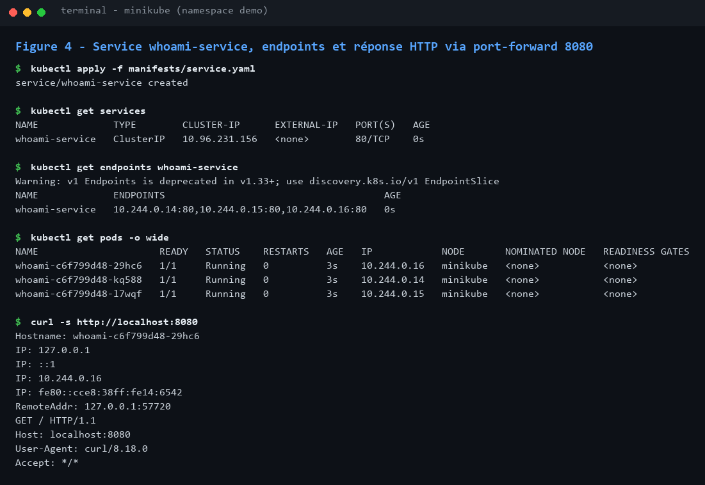
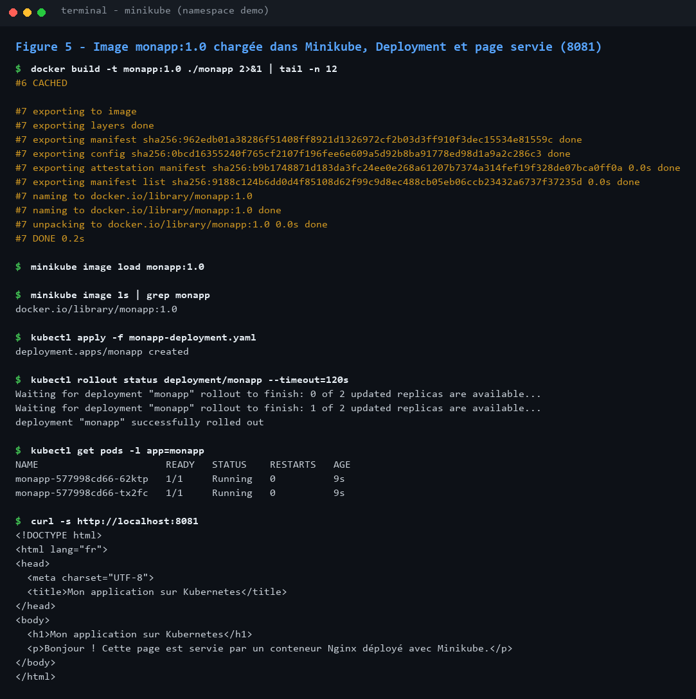
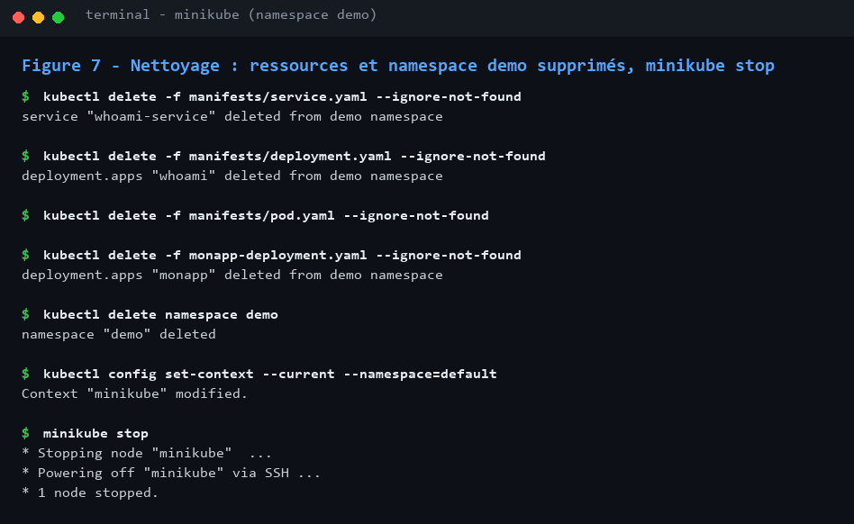

# Rapport de TP : premiers déploiements Kubernetes avec Minikube et Docker

**Binôme** : Adam Beloucif et Emilien Morice
**Formation** : EFREI, M2 Data Engineering & IA, module DevOps
**Date d'exécution** : 19 octobre 2026
**Dépôt** : https://github.com/Adam-Blf/tp-kubernetes-minikube

## Introduction

Ce TP fait passer une application de l'état de conteneur isolé à celui de charge
gérée par Kubernetes. On démarre un cluster local avec Minikube, puis on compare un
Pod autonome à un Pod géré par un Deployment. On observe ensuite l'auto-réparation et
la mise à l'échelle, on expose l'application par un Service, et on finit par déployer
une image construite soi-même.

Toutes les captures de ce rapport proviennent d'une même exécution complète du TP,
rejouée le 19/10/2026 par `scripts/rejouer_tp.sh`. Chaque capture est le rendu fidèle
de la sortie brute conservée à côté d'elle dans `preuves/*.txt`.

## Environnement

| Outil | Version |
|---|---|
| Docker (client et serveur) | 29.8.2 |
| kubectl (client) | v1.36.1 |
| Minikube | v1.39.0 |
| Kubernetes (nœud) | v1.37.0, runtime containerd 2.3.4 |
| Système | Windows 11 Pro, Docker Desktop (WSL2), driver docker |

## Démarrer et vérifier le cluster (§3)

Commandes : `docker version`, `kubectl version --client`, `minikube version`,
`minikube start --driver=docker`, `minikube status`, `docker ps`, `kubectl cluster-info`,
`kubectl get nodes -o wide`, `kubectl get pods -A`.



**Nœud.** Le cluster compte un seul nœud, `minikube`, de rôle `control-plane`, au statut
`Ready`, en Kubernetes v1.37.0 avec le runtime `containerd`. Avec le driver docker, ce
nœud est lui-même un conteneur Docker, visible dans `docker ps`. Il porte à la fois le
plan de contrôle et les charges applicatives.

**Trois composants système** observés dans le namespace `kube-system` :

- `kube-apiserver-minikube` : point d'entrée de l'API, par lequel passent kubectl et tous les autres composants ;
- `etcd-minikube` : base clé-valeur qui stocke l'état du cluster ;
- `coredns` : DNS interne qui résout les noms des Services.

On voit aussi `kube-scheduler`, `kube-controller-manager`, `kube-proxy`, `kindnet` (réseau)
et `storage-provisioner`.

Le profil Minikube existait déjà. `minikube start` le réutilise et signale qu'on ne peut
pas changer sa taille mémoire sans le supprimer, ce qui n'empêche pas le démarrage.

## Namespace et Pod autonome (§4)

On crée le namespace `demo`, on en fait le namespace courant, puis on applique
`manifests/pod.yaml` : un Pod `whoami-pod`, image `traefik/whoami:v1.10.3`, port 80.



`get`, `describe` et `logs` montrent un Pod `Running` qui écoute sur le port 80.

**Le `hostname` dans le conteneur.** `kubectl exec -it whoami-pod -- sh` échoue :
l'image `traefik/whoami` est minimale et ne contient ni shell ni binaire `hostname`.
On attache donc un conteneur de débogage éphémère `busybox` qui partage l'espace de
noms du Pod (`kubectl debug ... --target=whoami -- hostname`), et il renvoie bien
`whoami-pod`. L'avertissement affiché vient de ce que la commande se termine avant que
kubectl ait pu s'y attacher ; il bascule alors sur les journaux, qui contiennent la réponse.

**Suppression.** Après `kubectl delete pod whoami-pod`, `kubectl get pods` ne renvoie plus
rien : aucun contrôleur ne possède ce Pod, il ne revient pas.

Le Pod porte le label `app: whoami-pod` et non `app: whoami` : sinon le Service de la
partie 6 le sélectionnerait aussi.

## Deployment à trois réplicas (§5)

`manifests/deployment.yaml` décrit un Deployment `apps/v1` nommé `whoami`, à 3 réplicas.
Son `spec.selector.matchLabels` (`app: whoami`) correspond aux labels du modèle de Pod.



`kubectl get deployment,replicaset,pods` montre la chaîne de possession : le Deployment
`whoami` crée le ReplicaSet `whoami-c6f799d48`, qui crée trois Pods nommés d'après lui.
`--show-labels` confirme que chaque Pod porte `app=whoami` et le `pod-template-hash` du
ReplicaSet.

## Auto-réparation (§5)

On supprime un Pod du Deployment par son nom réel pendant qu'un second terminal observe
avec `kubectl get pods -w`.



Juste après la suppression, le Pod `cdvzq` est en `Terminating` à côté de son remplaçant
`dfhhb` en `ContainerCreating`. Le flux d'événements donne l'ordre exact : le Pod supprimé
passe en `Terminating`, le ReplicaSet crée aussitôt `dfhhb` (`Pending`, `ContainerCreating`,
`Running` en 2 secondes), et l'ancien Pod est retiré. On revient à trois Pods `Running`.

## Mise à l'échelle (§5)



- **5 réplicas** : deux Pods sont ajoutés, les trois existants sont conservés.
- **0 réplica** : les cinq Pods passent en `Terminating`, puis plus aucun Pod n'existe ; le Deployment et son ReplicaSet restent.
- **3 réplicas** : trois nouveaux Pods sont créés et `rollout status` confirme la fin du déploiement.

## Service (§6)

`manifests/service.yaml` décrit un Service `whoami-service` de type `ClusterIP`, qui
sélectionne `app: whoami` et envoie le port 80 vers le port nommé `http` des conteneurs.



Les trois endpoints (`10.244.0.14`, `.15`, `.16` sur le port 80) sont exactement les IP
des trois Pods données par `kubectl get pods -o wide` : le Service cible les bons Pods.
Via `kubectl port-forward service/whoami-service 8080:80`, `curl` reçoit la réponse de
`whoami`, dont la ligne `Hostname` porte le nom d'un Pod du Deployment.

## Image personnalisée (§7)

`monapp/index.html` contient un titre et un message en français, et `monapp/Dockerfile`
part de `nginx:1.27` et copie la page dans `/usr/share/nginx/html/`.



`docker build` produit `monapp:1.0`, `minikube image load` la copie dans le nœud
(`minikube image ls` la liste), puis `monapp-deployment.yaml` la déploie sur 2 réplicas
avec `imagePullPolicy: Never`. Les deux Pods sont `Running` et la page en français est
servie sur `localhost:8081`.

## Nettoyage (§10)



Toutes les ressources sont supprimées, ainsi que le namespace `demo`. On revient au
namespace `default` et `minikube stop` arrête le nœud. Le cluster est conservé et
pourra redémarrer sans tout retélécharger.

## Questions de synthèse (§8)

**Pod autonome et Pod géré par un Deployment.** Le Pod autonome n'a aucun propriétaire :
supprimé ou planté, il est perdu (figure 6). Le Pod géré par un Deployment appartient à
un ReplicaSet qui maintient le nombre de réplicas voulu (figure 3). Le Deployment apporte
aussi la mise à l'échelle et les mises à jour progressives avec retour arrière.

**Rôle du ReplicaSet dans l'auto-réparation.** Il compare en continu le nombre de Pods qui
correspondent à son sélecteur au nombre désiré. Dès qu'il voit un écart, il crée ou
supprime des Pods pour revenir à l'état désiré : c'est la boucle de réconciliation.
Le même mécanisme joue pour un Pod supprimé et pour un `scale`.

**Rôle du Service et vérification.** Les Pods sont éphémères et changent d'IP à chaque
recréation. Le Service offre une IP et un nom DNS stables, et répartit le trafic entre
les Pods dont les labels correspondent à son sélecteur. Pour vérifier qu'il cible les bons
Pods, on compare ses endpoints aux IP de `kubectl get pods -o wide`, on contrôle les
labels avec `--show-labels`, et on teste une requête. Si les endpoints sont vides, le
sélecteur ne correspond à aucun Pod prêt.

**Image chargée dans Minikube et `imagePullPolicy: Never`.** Le nœud Minikube a son propre
runtime et son propre stock d'images, séparé du Docker de l'hôte. `monapp:1.0` n'existe
qu'en local et n'est sur aucun registre : `minikube image load` la copie dans le nœud.
`imagePullPolicy: Never` force kubelet à utiliser cette copie sans tenter de la télécharger.
Sans cela, il la chercherait sur Docker Hub et le Pod finirait en `ErrImagePull` ou en
`ImagePullBackOff`.

## Difficultés rencontrées

- **Pas de shell dans `traefik/whoami`** : résolu par un conteneur de débogage éphémère.
- **Minikube sur un profil existant** : redémarrage long la première fois, et taille mémoire non modifiable sans `minikube delete`.
- **Machine partagée** : une stack Kafka, Spark et Postgres d'un autre TP tournait en parallèle.
- **`port-forward`** : il s'attache à un seul Pod, donc la répartition du Service ne s'observe pas par `curl` à travers lui.
- **Endpoints dépréciés** : `kubectl get endpoints` avertit qu'EndpointSlice le remplace depuis Kubernetes 1.33.

## Répartition dans le binôme

Emilien Morice a préparé la partie Pod autonome : la démarche, la conclusion et une
première version de `pod.yaml`, reprises dans la mini doc `docs/pod-autonome.md`. Adam
Beloucif a réalisé le cluster, le Deployment, le Service, l'image personnalisée, les
preuves, l'intégration continue et ce rapport.

## Conclusion

Le TP montre ce que Kubernetes ajoute à Docker : un état désiré déclaré dans des
manifestes, et des contrôleurs qui le maintiennent. Un Pod seul ne vaut guère mieux qu'un
`docker run` ; avec un Deployment, la perte d'un Pod se répare en quelques secondes et la
capacité change d'une commande. Le Service découple les clients de la vie des Pods.
Enfin, le cas de l'image locale rappelle que le nœud est une machine distincte, avec son
propre stock d'images.

## Annexe : manifestes

`manifests/pod.yaml`

```yaml
apiVersion: v1
kind: Pod
metadata:
  name: whoami-pod
  namespace: demo
  labels:
    app: whoami-pod
spec:
  containers:
    - name: whoami
      image: traefik/whoami:v1.10.3
      ports:
        - containerPort: 80
          name: http
```

`manifests/deployment.yaml`

```yaml
apiVersion: apps/v1
kind: Deployment
metadata:
  name: whoami
  namespace: demo
  labels:
    app: whoami
spec:
  replicas: 3
  selector:
    matchLabels:
      app: whoami
  template:
    metadata:
      labels:
        app: whoami
    spec:
      containers:
        - name: whoami
          image: traefik/whoami:v1.10.3
          ports:
            - containerPort: 80
              name: http
```

`manifests/service.yaml`

```yaml
apiVersion: v1
kind: Service
metadata:
  name: whoami-service
  namespace: demo
spec:
  type: ClusterIP
  selector:
    app: whoami
  ports:
    - name: http
      port: 80
      targetPort: http
```

`monapp-deployment.yaml`

```yaml
apiVersion: apps/v1
kind: Deployment
metadata:
  name: monapp
  namespace: demo
  labels:
    app: monapp
spec:
  replicas: 2
  selector:
    matchLabels:
      app: monapp
  template:
    metadata:
      labels:
        app: monapp
    spec:
      containers:
        - name: monapp
          image: monapp:1.0
          imagePullPolicy: Never
          ports:
            - containerPort: 80
              name: http
```

`monapp/Dockerfile`

```dockerfile
FROM nginx:1.27
COPY index.html /usr/share/nginx/html/index.html
```
